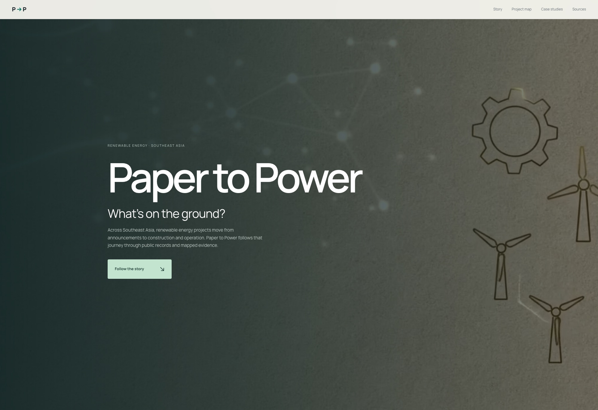
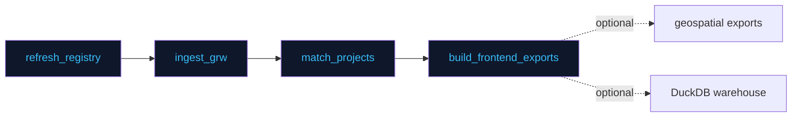

<div align="center">

# ⚡ Paper to Power

**A public evidence explorer for renewable-energy project claims across Southeast Asia.**

[](https://energy.faizkrisnadi.com)
[](#-release-snapshot)
[](#-release-snapshot)

[](https://nodejs.org)
[](https://www.python.org)
[](https://docs.astral.sh/uv/)
[](https://react.dev)
[](https://maplibre.org)
[](docs/cloudflare-deployment.md)
[](#-reuse)

</div>

---



Paper to Power separates **documentary claims**, **observed physical footprints**, **commissioning dates**, **source review** and **nearby infrastructure** — so that missing information cannot become a verdict about project delivery.

> [!IMPORTANT]
> Record counts are **not unique plants**. The preserved research baseline has **50 unique projects**, including 14 documentary reviews; importing or linking a provider record does not create an independent review.

## 📊 Release snapshot

| | | | |
|:---:|:---:|:---:|:---:|
| **5,136** | **11** | **5,118** | **50** |
| records | Southeast Asian countries | provider units / phases (GEM, Sep 2026) | unique research projects |

| | | | |
|:---:|:---:|:---:|:---:|
| **2,311** | **2024 Q2** | **30** | **0** |
| GRW assets (5 countries) | observation extract cutoff | approved partial attributions (Tengeh & Sidrap) | fully eligible site reviews — so no non-detection % is published |

See [the current stage and identity reconciliation](docs/stage-and-identity-reconciliation.md) and [the initial provider refresh](docs/september-2026-refresh.md). The validated regional release is **live** — Cloudflare Pages builds pushes to `main` with `npm run build:web` and serves `dist` ([deployment configuration](docs/cloudflare-deployment.md)).

## 🚀 Quick start

**Requirements:** Node.js ≥ 22.12, Python 3.11–3.13, [uv](https://docs.astral.sh/uv/). Both JS and Python dependency resolutions are committed.

```bash
npm ci
uv sync --locked --all-extras --python 3.11

# Full local release workflow
npm run build:data      # canonical registry + frontend exports (no network)
npm run build:research  # proximity, GeoJSON/Parquet, DuckDB warehouse, site audit
npm test                # pytest suite
npm run lint            # eslint
npm run build           # build:data + tsc + vite build
npm run validate:data   # release manifest validation
npm run dev             # local dev server
```

> [!NOTE]
> `build:data` reconstructs the canonical registry, saved observation assets, candidate matches, evidence labels and frontend exports **without network requests**. `build:research` rebuilds cached infrastructure proximity, GeoJSON/Parquet exports, the DuckDB warehouse and site-audit downloads. Fetching new sources is a separate research operation — a successful download does not establish identity, phase, coverage or claim validity.

<details>
<summary><b>☁️ Cloudflare Pages configuration</b></summary>

| Setting | Value |
| --- | --- |
| Production branch | `main` |
| Build command | `npm run build:web` |
| Output directory | `dist` |
| Repository root | `/` |

`build:web` compiles the committed, validated frontend data snapshot without fetching sources or requiring the Python research runtime. Data changes must still pass the full local release workflow above before being committed.

</details>

## 🧭 Release pipeline



Earlier import / enrichment / promote scripts are staging tools; their outputs must be reconciled into the explicit review inputs before entering this release. `npm run build:data` restores the canonical release from those inputs.

## 📁 Outputs

| Output | Purpose |
| --- | --- |
| `data/processed/project_registry.json` | Canonical projects, reviews and resolved aliases |
| `data/processed/match_candidates.json` | Unapproved spatial research candidates |
| `data/processed/project_asset_matches.json` | Explicitly approved attributions only |
| `data/processed/frontend_dataset.json`, `src/data/generated.ts` | Shared frontend evidence contract |
| `public/downloads/project-evidence.json`, `.csv` | Public evidence downloads |
| `data/processed/release_manifest.json` | Input and public-output SHA-256 hashes |
| `data/processed/geospatial/` | Active-release geometry, warehouse and audit exports |

## 📜 Evidence rules

- **Capacity bases are preserved.** Documentary capacity retains its reported AC, DC/MWp, unspecified or hybrid basis — incompatible bases are not summed into a delivery gap.
- **Geometry ≠ capacity.** Observed polygons and turbine points establish geometry only after explicit attribution review. Area and turbine counts are not converted into generation capacity.
- **Non-detection is earned, not assumed.** It requires suitable technology, included observation coverage, verified site coordinates, a reviewed expected operating date before the cutoff and a completed site review. A missing candidate is insufficient.
- **First-seen imagery ≠ commissioning.** Imagery dates do not establish commissioning dates or schedule compliance.
- **Proximity is not connection.** Infrastructure proximity describes the saved open-map extract, not a grid connection or evacuation capacity. Unknown snapshot dates and coverage remain visible.
- **Every approval is traceable.** Each candidate approval requires a reviewer, date, reason, supporting URLs and fingerprints of both the project and asset. Stale approvals fail validation. Multiple assets may belong to one project, but one asset cannot silently be allocated to multiple phases.

See [the methodology](docs/evidence-methodology.md), [repair checkpoint](docs/repair-checkpoint-2026-10-05.md) and [source and reuse notes](docs/data-rights.md).

## 🗺️ The interface

The site opens with a **cinematic video hero** and fixed section navigation, followed by the **four-chapter animated regional map story**:

- 🔎 **Explorer** — leads with country, technology and reported project stage; observation review filters expand on demand. Research overviews link to individual provider phases.
- 🌏 **Country index** — follows the explorer.
- 🛰️ **Interactive evidence pilot** — Tengeh and Sidrap close the regional story with geographic basemaps, reviewed GRW geometry, a detection timeline and keyboard-accessible asset selection. A quarter slider reveals first detections while retaining the distinction between detection and commissioning. Readers can select geometry, inspect phase reasoning and download all 35 decisions plus the attributed reference GeoJSON.

> [!WARNING]
> The pilot reference is **community-mapped geometry, not an engineering survey**. Its retrieval date and ODbL attribution are explicit.

Manrope is used consistently across interface headings, body text and controls.

## ✅ Validation & remaining research

The test suite covers date precision, temporal and technology exclusions, unknown-versus-zero behavior, reviewed matching, stale approvals, duplicate resolution, deterministic exports, source-review provenance and CSV formula protection. GitHub Actions runs locked installation, rebuilds, tests, lint, production build, release validation and the dependency audit.

<details>
<summary><b>🧪 Optional browser smoke checks</b></summary>

```bash
uv run --extra test python tests/browser_smoke.py   # against a preview on port 4173
uv run --extra test playwright install chromium     # or set CHROME_PATH to an existing Chrome binary
```

`PREVIEW_URL` and `BROWSER_ARTIFACTS` can override the preview address and screenshot directory.

</details>

The remaining research queue for this release:

- 📋 Independent documentary review of the **5,122 records** whose claim review is still pending (14 of 5,136 records are reviewed)
- 🧩 Follow-up on the **10 research records** whose provider identity remains unresolved after the September 2026 reconciliation
- 📍 Verification of project coordinates
- 🛰️ Review of the **53,327 spatial candidates** still unreviewed after the 30 approved attributions and 5 exclusions (the candidate screen runs over the full 5,136-record population since the provider import, so this queue supersedes the 279 candidates of the 50 research records alone — an unreviewed candidate is a review lead, not a confirmed match)
- 🗓️ Any justified observation updates after June 2024

Tengeh and Sidrap now have reviewed partial asset bundles; Claveria's offshore proposal is outside the current method and its reviewed commercial target is April 2032. No new satellite inference or imagery acquisition has been performed in this repair.

## ✏️ Editing the data

| File | Edit for |
| --- | --- |
| `data/manual/registry_reviews.json` | Sourced documentary corrections |
| `data/manual/match_reviews.json` | Asset decisions |
| `data/manual/registry_baseline.json` | ⚠️ Preserves the original registry incl. legacy values — do not overwrite |

> [!CAUTION]
> Do not edit generated frontend data as a substitute for reviewing source records.

## ⚖️ Reuse

> [!NOTE]
> **No project code license has been granted here.** Treat reuse as restricted until the owner chooses a license. External data and maps have their own terms and attribution requirements — see [`docs/data-rights.md`](docs/data-rights.md). A source citation does not grant redistribution rights to a full report or dataset.

---

<div align="center">

**[energy.faizkrisnadi.com](https://energy.faizkrisnadi.com)** · [Docs](docs/) · [Evidence downloads](public/downloads/)

*Paper to Power — because missing information is not a verdict.*

</div>
